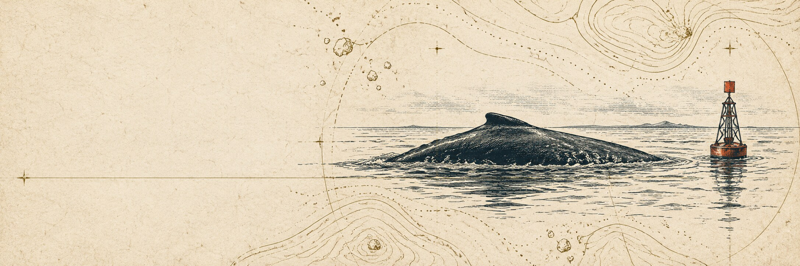
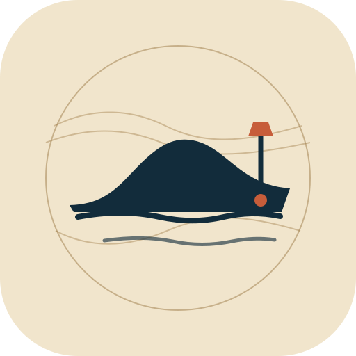

# Ahab brand

**Selected direction: Logbook.** The root README now uses its banner and mark. Ahab is the software; **Pip** is the agent running on it.

## Logbook





An archival field note about a whale and a buoy. It connects Ahab's maritime name to the project's strongest idea: a life that accumulates through written memory.

Palette: `#F1E5CC` paper · `#122C3B` ink · `#C75D3A` vermilion · `#9D7B47` brass.

## Other explorations

**Sounding Line** pairs sonar rings with a whale fluke, for a more software-like direction. Palette: `#08151E` ink navy · `#DDE7DF` bone · `#3F8486` sea glass · `#D1A15C` brass.

**The Watch** sends a beacon over dark water, emphasizing the assistant's heartbeat and initiative. Palette: `#080D16` midnight · `#E9E3D8` chalk · `#F25B28` signal orange · `#384654` blue-gray.

Those concepts remain in their folders under `proposals/` for reference.

## Use

The selected banner and scalable mark are:

- `branding/proposals/logbook/banner.jpg` — 2172 × 724 README or social banner.
- `branding/proposals/logbook/mark.svg` — square vector mark for profile and app use.

Embed the banner in a repository README with:

```html
<p align="center">
  
</p>
```

The generated art has no embedded lettering, so the project name stays real text wherever the image is used.
