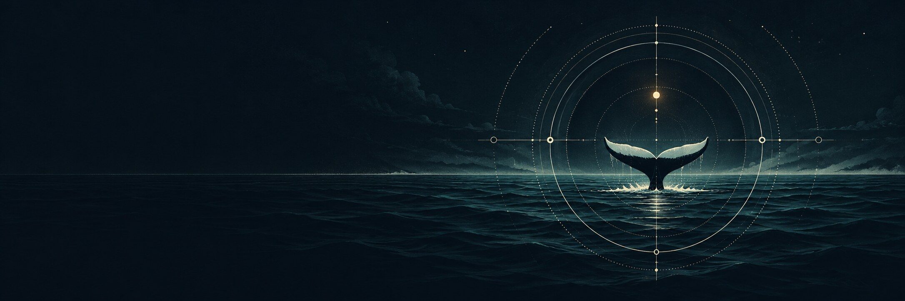
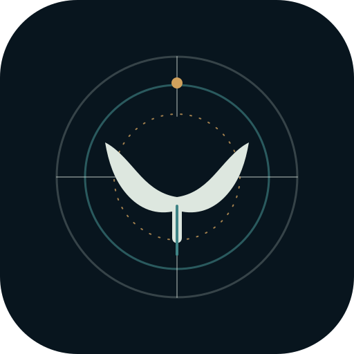
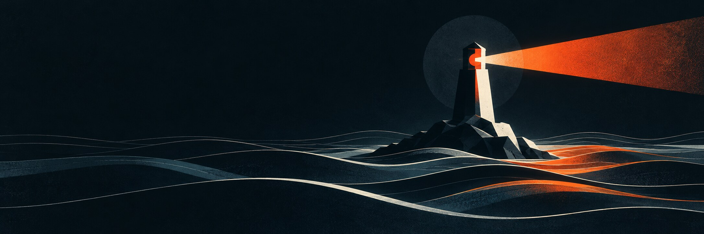
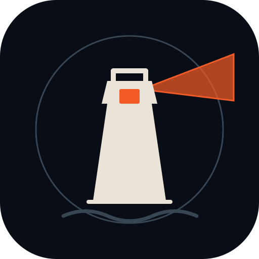

# Ahab brand exploration

Three visual directions for **Ahab**, the persistent personal-assistant runtime. Ahab is the software; **Pip** is the agent running on it. These are proposals, not a choice applied to the main README or application.

Each folder contains a scalable app/profile mark (`mark.svg`) and a wide generated banner (`banner.jpg`) that can be used in the README, a social preview, or other project pages. The art is deliberately free of embedded lettering so the project name can be set as real text wherever it is used.

## 1. Sounding Line





Sonar rings hold a whale fluke: a signal that keeps finding its way back. This is the most software-like option and the easiest to carry across dark interfaces.

Palette: `#08151E` ink navy · `#DDE7DF` bone · `#3F8486` sea glass · `#D1A15C` brass.

## 2. Logbook


An archival field note about a whale and a buoy. It connects Ahab's maritime name to the project's strongest idea: a life that accumulates through written memory.

Palette: `#F1E5CC` paper · `#122C3B` ink · `#C75D3A` vermilion · `#9D7B47` brass.

## 3. The Watch





A beacon crosses the dark water. It emphasizes the assistant's heartbeat and initiative without relying on a whale illustration. This is the boldest and most legible icon at small sizes.

Palette: `#080D16` midnight · `#E9E3D8` chalk · `#F25B28` signal orange · `#384654` blue-gray.

## README use

Once a direction is chosen, the banner can sit above the existing README title:

```html
<p align="center">
  
</p>
```

Swap `watch` for `sounding-line` or `logbook`. For a compact icon, use that option's `mark.svg`. The generated art is 2172 × 724; the marks are vector SVGs.
